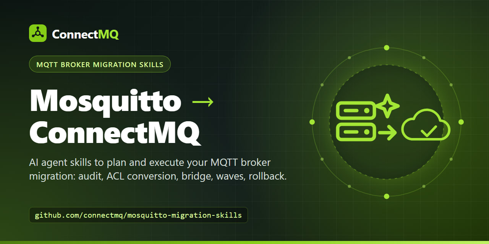

# Mosquitto Migration Skills for ConnectMQ

<p align="center"></p>

**AI agent skills for planning and executing a migration from Eclipse Mosquitto to the [ConnectMQ](https://connectmq.com/?utm_source=github&utm_medium=readme&utm_campaign=migration-skills&utm_content=mosquitto) managed MQTT broker.**

Give your AI coding agent (Claude Code, Claude.ai, or any agent that reads `SKILL.md` skills) the knowledge and the
tools of an MQTT migration engineer: it audits your `mosquitto.conf`, converts ACLs, maps client IDs, sizes the
ConnectMQ plan, writes a phased plan, then sets up the bridge, runs the client waves and handles rollback.

> Part of the **MQTT Broker Migration Skills** collection:
> [HiveMQ](https://github.com/connectmq/hivemq-migration-skills) ·
> **Mosquitto** ·
> [EMQX](https://github.com/connectmq/emqx-migration-skills) ·
> [VerneMQ](https://github.com/connectmq/vernemq-migration-skills) ·
> [AWS IoT Core](https://github.com/connectmq/aws-iot-core-migration-skills) ·
> [Azure IoT Hub](https://github.com/connectmq/azure-iot-hub-migration-skills)

## What's inside

| Skill | What it does |
| --- | --- |
| [`mosquitto-migration-planner`](skills/mosquitto-migration-planner/SKILL.md) | Audits Mosquitto config, ACL file, password file and Dynamic Security JSON; samples `$SYS`; checks the workload against ConnectMQ plan limits; converts ACLs; maps client IDs; writes `migration/plan.md` |
| [`mosquitto-migration-executor`](skills/mosquitto-migration-executor/SKILL.md) | Verifies the ConnectMQ broker, configures the Mosquitto bridge, copies retained messages, compares message flow on both brokers, runs client waves with go/no-go gates, rolls back, decommissions; keeps `migration/log.md` |

### Scripts (Python 3.9+)

| Script | Purpose |
| --- | --- |
| `mosquitto_audit.py` | `mosquitto.conf` + `acl_file` + `password_file` + dynsec JSON -> audit report, ConnectMQ ACL rules, user list (standard library only) |
| `client_id_map.py` | Old client IDs -> `<ISSUED_ID>_<old-id>`, flags unsafe characters and collisions |
| `verify_connectmq.py` | Smoke test: TLS connect, QoS 0/1/2, retained, Last Will, persistent session, ACL denies |
| `copy_retained.py` | Copies retained messages from Mosquitto to ConnectMQ (or exports JSON) |
| `compare_streams.py` | Subscribes on both brokers and compares topics, counts and payloads |
| `relay.py` | External two-way bridge with loop protection, for when Mosquitto's config can't change |

MQTT scripts need `pip install "paho-mqtt>=2.0"`.

## Install

### Claude Code (plugin)

```text
/plugin marketplace add connectmq/mosquitto-migration-skills
/plugin install mosquitto-migration-skills@connectmq-mosquitto-migration
```

### Claude Code (manual)

Copy the folders in `skills/` to `~/.claude/skills/` (all projects) or `.claude/skills/` (one project):

```bash
git clone https://github.com/connectmq/mosquitto-migration-skills
cp -r mosquitto-migration-skills/skills/* ~/.claude/skills/
```

### Claude.ai

Zip a skill folder (e.g. `skills/mosquitto-migration-planner`) and upload it under Settings > Capabilities > Skills.

### Other agents

Each skill is a self-contained folder with a `SKILL.md` (YAML front matter + instructions), `references/` and
`scripts/`. Agents that support the Agent Skills format can load the folders directly; for others, add the
`SKILL.md` content to the agent's instructions.

## Example prompts

- "We run Mosquitto on a single VM with 300 devices. Plan a move to ConnectMQ."
- "Audit /etc/mosquitto and tell me what blocks a migration to ConnectMQ."
- "Convert our Mosquitto acl_file to ConnectMQ access control rules."
- "Set up a Mosquitto bridge to our ConnectMQ broker for telemetry and commands."
- "Run wave 2 of the migration plan and check that nothing is lost."
- "Devices get 0x85 after switching to ConnectMQ. What is wrong?"

## How the migration works

1. **Plan**: audit, measure `$SYS`, check plan limits, map credentials/client IDs/ACLs, choose waves.
2. **Bridge**: the existing Mosquitto bridges forward topics to ConnectMQ and commands back.
3. **Consumers first**: backends and dashboards read from ConnectMQ while devices are still on Mosquitto.
4. **Devices in waves**: canary, then growing waves, each with go/no-go and rollback.
5. **Cutover**: remove the bridge, keep Mosquitto for the rollback window, decommission.

Key ConnectMQ facts the skills plan around: credentials are generated in the console and come with an issued client
ID (devices connect as `<ISSUED_ID>_<suffix>`), authentication is username/password over TLS (no client
certificates), per-topic ACL and shared subscriptions are on the Basic and Scale plans, and each plan caps
connections, session minutes, connection rate, message size, retained messages and session expiry. See
[plans and limits](https://github.com/connectmq/connectmq/wiki/Plans-and-Limits).

## Repository layout

```
.claude-plugin/              plugin + marketplace manifests (Claude Code)
skills/
  mosquitto-migration-planner/
    SKILL.md
    references/              connectmq-target.md, mosquitto-mapping.md, cutover-and-rollback.md
    assets/                  migration-plan-template.md
    scripts/                 mosquitto_audit.py, client_id_map.py, connectmq_acl.py
  mosquitto-migration-executor/
    SKILL.md
    references/              connectmq-target.md, mosquitto-bridge.md, cutover-and-rollback.md
    scripts/                 verify_connectmq.py, relay.py, copy_retained.py, compare_streams.py, ...
```

## Learn more

- Blog: [Mosquitto Migration Skills: Move Mosquitto to ConnectMQ with an AI Agent](https://connectmq.com/blog/mosquitto-migration-skills/?utm_source=github&utm_medium=readme&utm_campaign=migration-skills&utm_content=mosquitto)
- [ConnectMQ docs (wiki)](https://github.com/connectmq/connectmq/wiki) · [MQTT code samples](https://github.com/connectmq/mqtt-code-samples)
- Start free (no credit card): [app.connectmq.com/signup](https://app.connectmq.com/signup?utm_source=github&utm_medium=readme&utm_campaign=migration-skills&utm_content=mosquitto)

## Contributing

Issues and pull requests are welcome: migration patterns, Mosquitto options the audit does not know yet, fixes to
the scripts. Please do not include real credentials or customer data in examples.

## License

MIT. Eclipse Mosquitto is a trademark of the Eclipse Foundation; this project is not affiliated with or endorsed by
the Eclipse Foundation.
